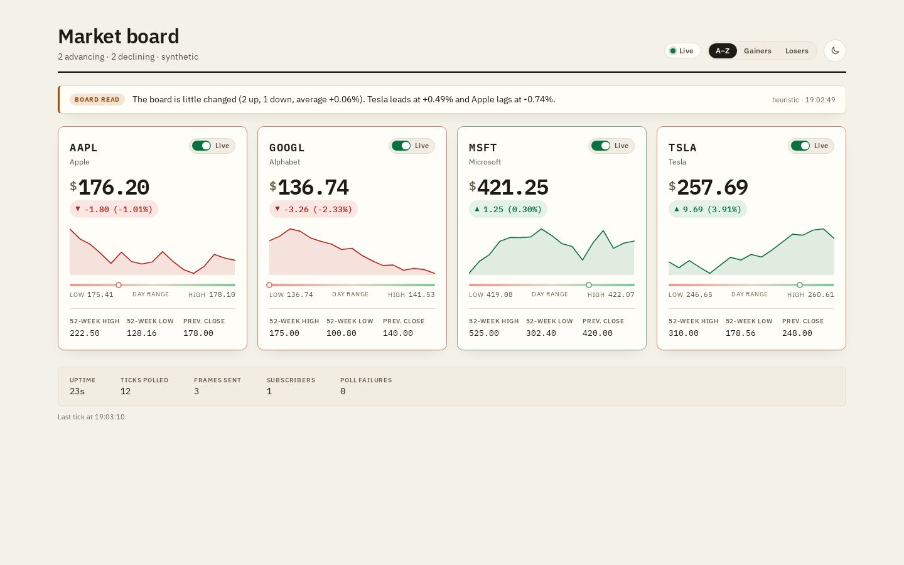
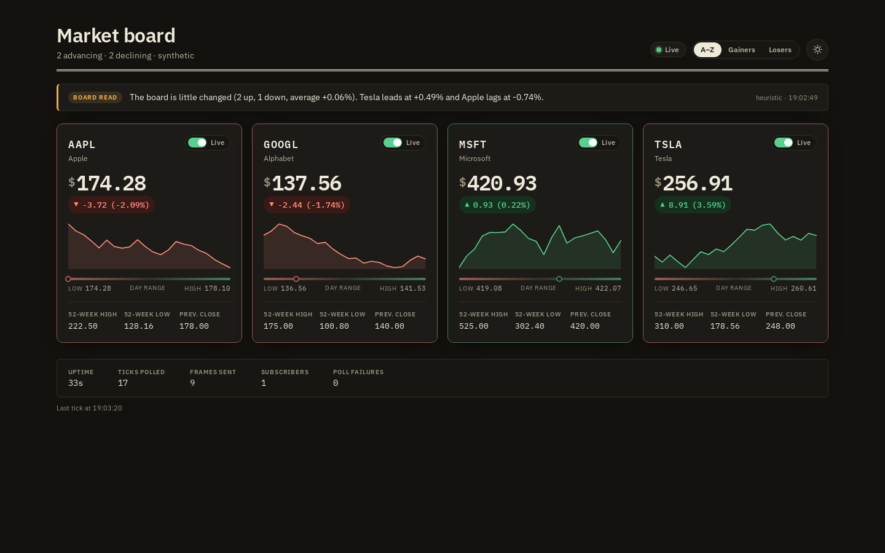
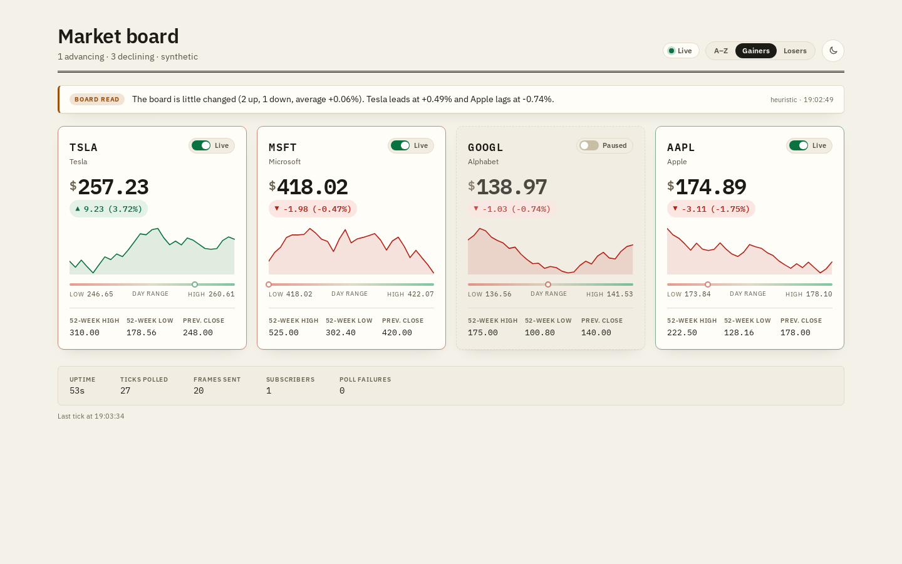
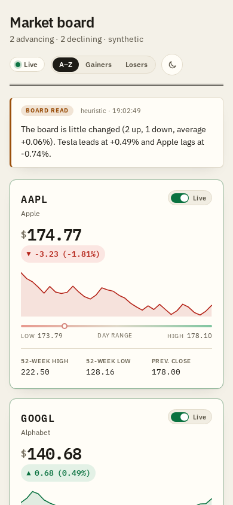
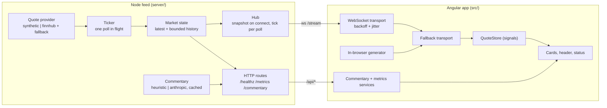

# Market board

A live quote board for four symbols (AAPL, GOOGL, MSFT, TSLA). An Angular 21 app renders the board; a small Node process polls a quote source and pushes every symbol's new price to the browser over one WebSocket.

It needs no accounts and no keys. Without `FINNHUB_API_KEY` the feed generates a seeded random walk, so the same seed replays the same session. If the feed can't be reached at all, the browser switches to its own copy of that generator and changes back when the feed returns.



| Dark theme                                       | Sorted by gainers, GOOGL paused                                                    | Phone                                              |
| ------------------------------------------------ | ---------------------------------------------------------------------------------- | -------------------------------------------------- |
|  |  |  |

## What it does

- One card per symbol: price, change against the previous close, a sparkline of the last 40 prices, where the price sits in the day's range, the 52-week band and the previous close.
- Pause a single card. It keeps the price it was paused at while the others keep moving.
- Sort A–Z, gainers first or losers first. The header counts advancing and declining symbols (moves within ±0.15% count as flat).
- A status pill says where the numbers come from: Connecting, Live, Reconnecting, Demo data or Stopped.
- A one-sentence "board read" from the feed. By default it is computed from the numbers. With `ANTHROPIC_API_KEY` set, Claude writes it, and any failure falls back to the computed sentence. The strip names the provider that wrote it.
- A footer with the feed's own health: uptime, polls, frames sent, subscribers, poll failures and the last error.
- Light and dark themes. The board follows the system setting, a toggle overrides it, and `?theme=dark` links straight to one.

## Run it

### With Docker (one command)

```bash
docker compose up --build
```

Open http://localhost:7201. Compose builds two images from the one `Dockerfile`: `feed` (Node 22, non-root) and `web` (unprivileged nginx serving the built app). nginx forwards `/stream` and `/api/*` to the feed, so the browser only ever talks to one origin. Set `WEB_PORT` to use another port.

### Without Docker

Node 22 (see `.nvmrc`). Start the feed in one terminal:

```bash
npm ci --prefix server
npm run feed            # http://127.0.0.1:7202, ws://127.0.0.1:7202/stream
```

and the app in another:

```bash
npm ci
npm start               # http://localhost:7201
```

The dev server proxies `/api` to the feed (`proxy.conf.json`) and the app opens the WebSocket on `ws://localhost:7202/stream`. If you start only the app, it shows "Reconnecting" for a few seconds and then runs on in-browser demo data.

## Configuration

Every setting is optional; `.env.example` lists them all with their defaults. Compose passes the main ones through from your shell or a `.env` file.

| Variable                | Default                                       | Effect                                                                                                        |
| ----------------------- | --------------------------------------------- | ------------------------------------------------------------------------------------------------------------- |
| `FINNHUB_API_KEY`       | unset                                         | Use live Finnhub quotes. A Finnhub outage falls back to generated prices, and the provider shows as degraded. |
| `QUOTE_PROVIDER`        | `synthetic`, or `finnhub` when a key is set   | Force a quote source.                                                                                         |
| `FEED_SEED`             | `20240695`                                    | Seed for the generated walk.                                                                                  |
| `ANTHROPIC_API_KEY`     | unset                                         | Let Claude write the board read.                                                                              |
| `COMMENTARY_PROVIDER`   | `heuristic`, or `anthropic` when a key is set | Force the commentary source.                                                                                  |
| `COMMENTARY_MODEL`      | `claude-opus-5`                               | Model used for the board read.                                                                                |
| `COMMENTARY_TTL_MS`     | `60000`                                       | How long one generated sentence is reused.                                                                    |
| `POLL_INTERVAL_MS`      | `2000`                                        | How often the feed polls its quote source.                                                                    |
| `HEARTBEAT_INTERVAL_MS` | `15000`                                       | WebSocket ping interval. A client that misses two pings is dropped.                                           |
| `HISTORY_DEPTH`         | `40`                                          | Prices kept per symbol for the sparklines.                                                                    |
| `PORT`, `HOST`          | `7202`, `127.0.0.1`                           | Where the feed listens.                                                                                       |

The symbol list lives in `shared/symbols.json`. The app imports it at build time and the feed reads it at start-up, so the two can't disagree.

## How it fits together



Design choices worth knowing about:

- **One frame per poll.** A `tick` carries every symbol, so the app runs one change-detection pass per poll rather than one per symbol. A new client first gets a `snapshot` with the whole board and its history, so it never sits empty until the next poll.
- **The store owns all state.** Cards are presentational and use OnPush. Pausing is handled in `QuoteStore`, which keeps the frozen quote. A snapshot from a different source (demo generator to live feed) replaces the board instead of merging into it.
- **Nothing grows without bound.** History is capped on both sides. A client that stops draining its socket is dropped once 1 MiB is buffered. A poll that is still running when the next one is due is skipped, not stacked.
- **Same generator on both sides.** The feed and the browser use the same seeded mulberry32 walk, and a test pins both copies to the same first value.
- **Commentary is cached server-side.** It is the only call that can cost money or take a second, so concurrent requests share one generation and the result is reused for `COMMENTARY_TTL_MS`.
- **Screen readers.** Prices are not a live region, because four cards ticking every two seconds would drown out everything else. The feed status pill is the status region, so connection changes are announced.

## The feed's interface

Captured from `docker compose up` with the default seed. Through nginx the HTTP routes sit under `/api`; on the feed's own port they sit at the root.

```console
$ curl -s localhost:7201/api/healthz
{"status":"ok","symbols":4,"lastError":null}

$ curl -s localhost:7201/api/metrics
{"uptimeSeconds":11,"sequence":6,"polls":6,"failures":0,"lastError":null,"clients":0,"framesSent":0,"clientsDropped":0}

$ curl -s localhost:7201/api/commentary
{"text":"The board is little changed (2 up, 1 down, average +0.06%). Tesla leads at +0.49% and Apple lags at -0.74%.","provider":"heuristic","generatedAt":"2026-11-07T19:02:49.336Z"}

$ curl -s localhost:7201/api/nope
{"error":"not found","routes":["/healthz","/metrics","/commentary","/stream (websocket)"]}
```

`/healthz` answers 503 `{"status":"starting"}` until the first poll lands, and `/commentary` answers 503 until there are quotes to describe.

WebSocket frames on `/stream`, trimmed to one symbol:

```json
{"type":"snapshot","sequence":6,"provider":"synthetic",
 "quotes":[{"symbol":"AAPL","name":"Apple","current":176.69,"dayHigh":178.1,"dayLow":176.01,
            "week52High":222.5,"week52Low":128.16,"previousClose":178,"change":-1.31,
            "changePercent":-0.74,"asOf":"2026-11-07T19:02:48.755Z"}],
 "history":{"AAPL":[177.16,176.62,176.01,176.69]}}
{"type":"tick","sequence":7,
 "quotes":[{"symbol":"AAPL","name":"Apple","current":176.12,"dayHigh":178.1,"dayLow":176.01,
            "week52High":222.5,"week52Low":128.16,"previousClose":178,"change":-1.88,
            "changePercent":-1.06,"asOf":"2026-11-07T19:02:50.767Z"}]}
```

The snapshot's history already ends with the current price. The app treats malformed frames as untrusted input and drops them without closing the stream.

## Tests and lint

```bash
npm run test:feed   # feed: node:test, includes an end-to-end run over a real socket
npm test            # app: Karma + Jasmine in headless Chrome
npm run test:all    # both
npm run lint        # ESLint (incl. template accessibility rules) + Prettier
```

Karma finds an installed Chrome on its own. Elsewhere, point `CHROME_BIN` at a Chromium binary. To run everything in a container with no local browser or Node:

```bash
docker run --rm -v "$PWD":/src:ro -w /work mcr.microsoft.com/playwright:v1.49.1-jammy bash -c '
  cp -a /src/. /work && rm -rf node_modules server/node_modules &&
  npm ci && npm ci --prefix server &&
  CHROME_BIN=$(ls -d /ms-playwright/chromium-*/chrome-linux/chrome) npm run test:all &&
  npm run lint && npm run build'
```

## Limitations

- The four symbols are fixed at build time. To change them, edit `shared/symbols.json`, then rebuild the app and restart the feed.
- Price history lives in memory, so a feed restart starts the sparklines again.
- Each feed process polls the vendor on its own, so running several replicas multiplies upstream calls.
- With generated data, the 52-week band is a fixed ratio of the reference price, not real history.

## License

MIT. See [LICENSE](LICENSE).
