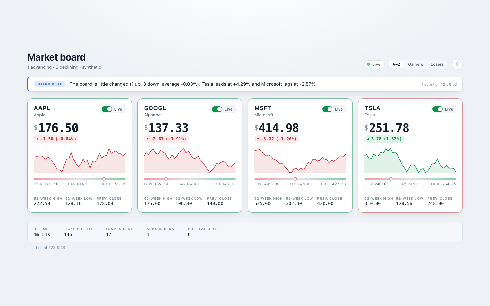
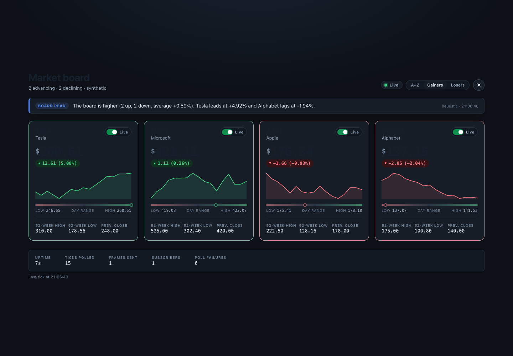

# Market board

A live stock quote dashboard. The frontend is an Angular 20 app showing four symbols (AAPL, GOOGL, MSFT, TSLA). A small Node server polls quotes and pushes them to the browser over a WebSocket.

No API keys are needed to try it. Without `FINNHUB_API_KEY` the server generates seeded random-walk prices instead of live quotes.



## Features

- Price cards with sparklines, trend arrows and 52-week range
- Pause a single symbol while the others keep updating
- Sort by gainers or losers
- Light and dark theme (follows the system setting, can be toggled)
- Reconnects automatically with backoff. If the feed is down, the page switches to in-browser demo data until it comes back.
- A one-line summary of the board, computed from the numbers (or written by the Anthropic API if `ANTHROPIC_API_KEY` is set)

## Running locally

Validated on Node 22.22.3. Start the feed server first:

```bash
npm install --prefix server
npm run feed
```

It listens on `127.0.0.1:7202`. Then in another terminal:

```bash
npm install
npm start
```

The app runs at http://localhost:7201 and proxies `/api` to the feed (see `proxy.conf.json`).

Or run both with Docker:

```bash
docker compose up --build
```

## Configuration

All settings are optional. See `.env.example` for the full list. The main ones:

- `FINNHUB_API_KEY`: use live Finnhub quotes
- `QUOTE_PROVIDER`: `synthetic` or `finnhub`
- `FEED_SEED`: seed for the generated prices (same seed, same session)
- `ANTHROPIC_API_KEY`, `COMMENTARY_PROVIDER`: summary line source (`heuristic` or `anthropic`)
- `POLL_INTERVAL_MS`, `HISTORY_DEPTH`, `PORT`, `HOST`

The symbol list lives in `shared/symbols.json` and is used by both the app and the server.

## Feed endpoints

- `/stream`: WebSocket, sends a snapshot on connect and then a tick frame per poll
- `/healthz`: 200 once quotes are flowing
- `/metrics`: polls, failures, connected clients, last error
- `/commentary`: the current summary sentence

## Tests

```bash
npm run test:feed   # server tests (node:test)
npm test            # Angular tests (Karma, headless Chrome)
npm run test:all
npm run lint
```

The server suite includes an end-to-end test that starts the real server and connects over WebSocket.

## Limitations

- The four symbols are fixed. To change them, edit `shared/symbols.json` and restart.
- Price history is kept in memory only.
- Running more than one feed process would mean each polls the vendor separately.

## Native WebSocket verification



[Mobile capture](docs/screenshots/native-mobile.png) and
[browser checks](docs/native-browser.json). This run uses the actual Node feed
sidecar over WebSocket, seeded synthetic quotes, and heuristic commentary. It
checks four cards, incoming frames, per-symbol pause/resume, gainers sorting,
and the theme switch. No live quotes or hosted commentary were requested.

The framework and CLI moved together to Angular 20.3 with TypeScript 5.9, matching
[Angular's compatibility table](https://angular.dev/reference/versions).
All 95 Angular tests, 57 feed tests, the production build, and lint/format checks
pass. The production dependency audit reports no advisories for the updated
framework. Docker images remain unverified locally.
